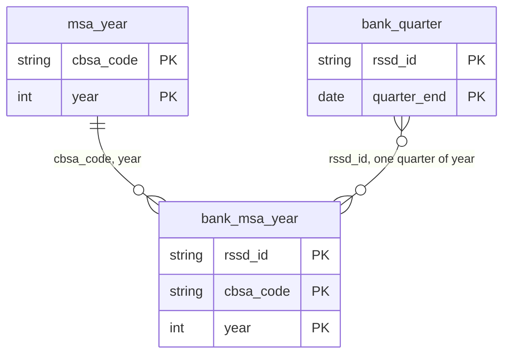

# Data Dictionary

Every column in `data/processed/` gets exactly one row here, in the same pull request that adds it. The checks read this file on every build: a processed column with no row, or with two, fails the build, and so does a value that doesn't fit its row's Type. A row for a column that isn't built yet only raises a warning, so a column can be documented before it's built.

## Conventions

- **Keys.** `cbsa_code` and `county_fips` are 5-character strings with leading zeros kept (`01073`, not `1073`). `year` is the year a measure describes, not the year it was released. `quarter_end` is the last day of the quarter. `rssd_id` is the FFIEC RSSD ID, stored as a string.
- **Geography.** Every year uses one OMB delineation vintage (`DELINEATION_VINTAGE` in `src/config.py`). Counties map to metros through `data/reference/county_cbsa_xwalk.csv`.
- **Column names.** `<source>_<measure>` in snake_case, e.g. `cbp_establishments_count`, `sod_deposits_usd`.
- **Type** is what the checks hold every value to: `int` (whole numbers; a column stored as decimals passes if every value is whole), `numeric` (any number), `string`, `string(N)` (text exactly N characters long, such as `cbsa_code`) or `date`. Missing values aren't checked.
- **Units go in the suffix**, and the automatic checks rely on them:
  - `_count`: a count, must be 0 or more
  - `_usd`: whole dollars (convert from thousands at ingest), must be 0 or more
  - `_usd_net`: whole dollars that can be negative, such as net income or charge-offs net of recoveries. No range check is applied
  - `_pct`: a percentage from 0 to 100
  - `_ratio`: a ratio published as a percent (1.25 means 1.25%), kept exactly as the source publishes it. It can be negative or above 100, as return on assets or loans-to-deposits can, so no range check is applied
  - `_share`: a fraction from 0 to 1
  - `_net`: a signed amount that can be negative, such as net migration or natural change. No range check is applied.
- **Missing means missing.** Leave a value empty when the source doesn't report it. Never fill with 0.
- **Released** is when the source published the value. The Charlotte back-test can only use values released before the decision date it simulates. `data/reference/release_dates.csv` dates the first release of every source, dataset and year the tables read, with one row per `source`, `dataset`, `year`, `quarter_end` (Call Reports only) and `release_type` (`initial`, `revised` or `final`; QCEW's preliminary annual averages count as `initial`). A year counts as available from its earliest `release_date`. The tables hold the latest revised values, so the back-test uses revised numbers on first-release timing.
  - FRED and LAUS get one `initial` row per year, the date that year's values first came out; their spring revisions get no rows.
  - PEP gets an `initial` row per year from the vintage that first published it (Vintage 2015 through 2024), plus `revised` rows for the three files the table reads: the 2010-2020 intercensal file (2015-2019 population), Vintage 2020 (2015-2019 flows) and Vintage 2025 (2020 on).
  - Call Reports are dated at `quarter_end` plus 35 days. Reports are due 30 days after the report date, 35 for institutions with more than one foreign office ([FDIC FIL-10-2026](https://www.fdic.gov/news/financial-institution-letters/2026/consolidated-reports-condition-and-income-first-quarter)). Amended filings get no rows.
  - Where no first-release date turned up, the row carries the earliest date the data can be shown to have been public, and its note says it is an upper bound.
  - CRE columns have no rows of their own: they read the same CBP county files and QCEW files as the `cbp` and `bls` rows. Bank-level CRA (`cra_bank`) shares the dates of the aggregate CRA release.

## Tables and keys

| Table | One row per | Key | Coverage |
|---|---|---|---|
| `msa_year` | metro and year | `cbsa_code`, `year` | Every metro in `data/reference/msa_universe.csv` (393), 2015–2024 |
| `bank_quarter` | bank and quarter | `rssd_id`, `quarter_end` | Every FDIC-insured bank with an RSSD ID, 2015 Q1 through the latest quarter FDIC has published |
| `bank_msa_year` | bank, metro and year | `rssd_id`, `cbsa_code`, `year` | Every bank with an office (SOD) or small business lending (CRA) in a metro, 2015–2024 |

Key columns are never empty and never repeat; the checks fail the build otherwise.

How the tables join:

- **A bank in a metro, next to the metro's economy:** `bank_msa_year` to `msa_year` on `cbsa_code` and `year`.
- **A bank's metro footprint, next to its financials:** `bank_msa_year` to `bank_quarter` on `rssd_id`, with one quarter of `year`. The June 30 quarter matches the SOD survey date, and the December 31 quarter closes the calendar year the CRA loans cover.
- **Organizations:** affiliated banks share `call_top_holder_rssd_id` in `bank_quarter` and `sod_top_holder_rssd_id` in `bank_msa_year`. Group by it to treat them as one competitor.

## msa_year: one row per metro per year

| Column | Type | Unit | Definition | Source and field | Released | Transformation |
|---|---|---|---|---|---|---|
| `cbsa_code` | string(5) | | Metro (CBSA) code | OMB delineation, List 1 | | |
| `cbsa_title` | string | | Metro name | `data/reference/msa_universe.csv` | | |
| `year` | int | | Year the measures describe | | | |
| `cbp_establishments_count` | int | count | Number of business establishments, all industries, in the county/metro | Census County Business Patterns, county file field `EST` | | Summed from county to metro via crosswalk |
| `cbp_employment_count` | int | count | Paid employment for the pay period including March 12, all industries | Census County Business Patterns, county file field `EMP` | | Summed from county to metro via crosswalk |
| `cbp_first_quarter_payroll_usd` | numeric | usd | First-quarter payroll, all industries | Census County Business Patterns, county file field `QP1` (reported in $1,000s) | | Converted from thousands to whole dollars (×1,000), then summed county to metro via crosswalk |
| `cbp_annual_payroll_usd` | numeric | usd | Annual payroll, all industries | Census County Business Patterns, county file field `AP` (reported in $1,000s) | | Converted from thousands to whole dollars (×1,000), then summed county to metro via crosswalk |
| `pep_population_count` | int | count | Resident population estimate for July 1 of the year | 2015-2019: Census Population Estimates intercensal county file cc-est2020int-agesex-all.csv, field `POPESTIMATE`, YEAR 7 to 11 (July 1); 2020 onward: Census Population Estimates county files (field `POPESTIMATE`) | 2020 onward: Vintage 2025, March 26, 2026 (latest release); 2015-2019: Intercensal 2010-2020 estimates, September 2025 | July 1 estimates and flows for the year ending June 30; summed county to metro via the crosswalk, missing counties left out, never counted as 0; 2015-2019 from the intercensal 2010-2020 file (YEAR 7 to 11) and 2020 onward from Vintage 2025; Connecticut metros are missing for 2015-2019 because the 2015-2019 files use the old county codes (09001-09015) that the crosswalk does not map. Puerto Rico metros have no rows: the Census county files do not include Puerto Rico's municipios, although the crosswalk lists them. Population is on the 2020 Census base for all years, so it is continuous across 2020; the flows are not. |
| `pep_natural_change_net` | int | net | Births minus deaths in the year ending June 30 (negative when deaths exceed births) | Census Population Estimates county files (field `NATURALINC` for 2015-2019, `NATURALCHG` for 2020 onward) | 2020 onward: Vintage 2025, March 26, 2026 (latest release); 2015-2019: Vintage 2020, date not confirmed | July 1 estimates and flows for the year ending June 30; summed county to metro via the crosswalk, missing counties left out, never counted as 0; the _net columns can be negative so they have no range check; 2015-2019 from Vintage 2020 and 2020 onward from Vintage 2025, so there is a break at the 2020 Census base; Connecticut metros are missing for 2015-2019 because Vintage 2020 uses the old county codes (09001-09015) that the crosswalk does not map; 2020 flows are blank (the Vintage 2025 file covers only April to June 2020). Flows come from Vintage 2020 for 2015-2019, so they do not sum exactly to the change in the intercensal population. |
| `pep_domestic_migration_net` | int | net | Net movement of residents between this area and the rest of the U.S. in the year ending June 30 (negative when more leave than arrive) | Census Population Estimates county files (field `DOMESTICMIG`) | 2020 onward: Vintage 2025, March 26, 2026 (latest release); 2015-2019: Vintage 2020, date not confirmed | July 1 estimates and flows for the year ending June 30; summed county to metro via the crosswalk, missing counties left out, never counted as 0; the _net columns can be negative so they have no range check; 2015-2019 from Vintage 2020 and 2020 onward from Vintage 2025, so there is a break at the 2020 Census base; Connecticut metros are missing for 2015-2019 because Vintage 2020 uses the old county codes (09001-09015) that the crosswalk does not map; 2020 flows are blank (the Vintage 2025 file covers only April to June 2020) Estimates for the most recent year are preliminary and are revised in the next vintage. Flows come from Vintage 2020 for 2015-2019, so they do not sum exactly to the change in the intercensal population. |
| `pep_international_migration_net` | int | net | Net movement of residents between this area and other countries in the year ending June 30 | Census Population Estimates county files (field `INTERNATIONALMIG`) | 2020 onward: Vintage 2025, March 26, 2026 (latest release); 2015-2019: Vintage 2020, date not confirmed | July 1 estimates and flows for the year ending June 30; summed county to metro via the crosswalk, missing counties left out, never counted as 0; the _net columns can be negative so they have no range check; 2015-2019 from Vintage 2020 and 2020 onward from Vintage 2025, so there is a break at the 2020 Census base; Connecticut metros are missing for 2015-2019 because Vintage 2020 uses the old county codes (09001-09015) that the crosswalk does not map; 2020 flows are blank (the Vintage 2025 file covers only April to June 2020) Estimates for the most recent year are preliminary and are revised in the next vintage. Flows come from Vintage 2020 for 2015-2019, so they do not sum exactly to the change in the intercensal population. |
| `pep_migration_net` | int | net | Domestic plus international net migration in the year ending June 30 (negative when more leave than arrive) | Census Population Estimates county files (field `NETMIG`) | 2020 onward: Vintage 2025, March 26, 2026 (latest release); 2015-2019: Vintage 2020, date not confirmed | July 1 estimates and flows for the year ending June 30; summed county to metro via the crosswalk, missing counties left out, never counted as 0; the _net columns can be negative so they have no range check; 2015-2019 from Vintage 2020 and 2020 onward from Vintage 2025, so there is a break at the 2020 Census base; Connecticut metros are missing for 2015-2019 because Vintage 2020 uses the old county codes (09001-09015) that the crosswalk does not map; 2020 flows are blank (the Vintage 2025 file covers only April to June 2020) Estimates for the most recent year are preliminary and are revised in the next vintage. Flows come from Vintage 2020 for 2015-2019, so they do not sum exactly to the change in the intercensal population. |
| `pep_counties_reported_count` | int | count | Number of the metro's counties with a published population estimate that year | Census Population Estimates county files (field `POPESTIMATE`, counted where present) | 2020 onward: Vintage 2025, March 26, 2026 (latest release); 2015-2019: Vintage 2020, date not confirmed | Count of counties with a population, summed county to metro via the crosswalk; compare with the metro's county total to spot missing counties (e.g. a metro short one county); 2015-2019 from Vintage 2020 and 2020 onward from Vintage 2025, so there is a break at the 2020 Census base; Connecticut metros are missing for 2015-2019 because Vintage 2020 uses the old county codes (09001-09015) that the crosswalk does not map. Puerto Rico metros have no rows: the Census county files do not include Puerto Rico's municipios, although the crosswalk lists them. |
| `pep_vintage_year` | int | year | The Census Population Estimates vintage of the flow columns (natural change and migration) the row's values come from: 2020 for 2015-2019, 2025 for 2020 onward. Population for 2015-2019 comes from the intercensal file; see pep_population_source | Census Population Estimates county files (co-est2020-alldata.csv or co-est2025-alldata.csv) | 2020 onward: Vintage 2025, March 26, 2026 (latest release); 2015-2019: Vintage 2020, date not confirmed | Set from the source file the year was read from (2020 for 2015-2019, 2025 for 2020 onward); not summed across counties |
| `pep_population_source` | string | | Where the population value comes from: Intercensal 2010-2020 for 2015-2019, Vintage 2025 for 2020 onward | Census Population Estimates county files | 2020 onward: Vintage 2025, March 26, 2026 (latest release); 2015-2019: Intercensal 2010-2020 estimates, September 2025 | Set from the source file the year was read from (Intercensal 2010-2020 for 2015-2019, Vintage 2025 for 2020 onward); not summed across counties |
| `cre_real_estate_establishments_count` | numeric | count | Establishments in real estate (NAICS 531) in the county/metro. Missing if no county published a row. Used as a proxy for CRE activity: NAICS 531 includes residential lessors, and these are business counts, not vacancy, rent or transactions. | Census County Business Patterns, county file field `EST`, NAICS `531///` | 2023 data: June 26, 2025 (latest release); QCEW 2024 data: final annual averages September 9, 2025 (preliminary June 4, 2025) | Summed county to metro via crosswalk; counties with no row are left out of the sum, never counted as 0. Where CBP has no value (no row, withheld, or 2024, which CBP has not published), the value comes from BLS QCEW private-ownership data; QCEW rows marked not disclosed have their employment and wages treated as missing, not 0. 2024 values come only from QCEW, which counts differently from CBP (for Charlotte 2023, QCEW ran about 11% higher on real estate establishments, 38% on nonresidential construction establishments and 19% on payroll), so a change from 2023 to 2024 is partly a change of source, not growth. See cre_<industry>_qcew_fallback_counties_count for where QCEW is used. |
| `cre_real_estate_employment_count` | numeric | count | Paid employment in real estate (NAICS 531). Missing where withheld. Used as a proxy for CRE activity: NAICS 531 includes residential lessors, and these are business counts, not vacancy, rent or transactions. | Census County Business Patterns, county file field `EMP`, NAICS `531///` | 2023 data: June 26, 2025 (latest release); QCEW 2024 data: final annual averages September 9, 2025 (preliminary June 4, 2025) | 2015-2017 withheld cells (flag D or S, value 0) set to missing; from 2018 Census adds noise instead of withholding. Summed county to metro via crosswalk. Where CBP has no value (no row, withheld, or 2024, which CBP has not published), the value comes from BLS QCEW private-ownership data; QCEW rows marked not disclosed have their employment and wages treated as missing, not 0. 2024 values come only from QCEW, which counts differently from CBP (for Charlotte 2023, QCEW ran about 11% higher on real estate establishments, 38% on nonresidential construction establishments and 19% on payroll), so a change from 2023 to 2024 is partly a change of source, not growth. See cre_<industry>_qcew_fallback_counties_count for where QCEW is used. |
| `cre_real_estate_payroll_usd` | numeric | usd | Annual payroll in real estate (NAICS 531). Missing where withheld. Used as a proxy for CRE activity: NAICS 531 includes residential lessors, and these are business counts, not vacancy, rent or transactions. | Census County Business Patterns, county file field `AP` (reported in $1,000s), NAICS `531///` | 2023 data: June 26, 2025 (latest release); QCEW 2024 data: final annual averages September 9, 2025 (preliminary June 4, 2025) | Converted from thousands to whole dollars (x1,000); withheld cells set to missing; summed county to metro via crosswalk. Where CBP has no value (no row, withheld, or 2024, which CBP has not published), the value comes from BLS QCEW private-ownership data; QCEW rows marked not disclosed have their employment and wages treated as missing, not 0. 2024 values come only from QCEW, which counts differently from CBP (for Charlotte 2023, QCEW ran about 11% higher on real estate establishments, 38% on nonresidential construction establishments and 19% on payroll), so a change from 2023 to 2024 is partly a change of source, not growth. See cre_<industry>_qcew_fallback_counties_count for where QCEW is used. |
| `cre_real_estate_counties_reported_count` | int | count | Counties in the metro with establishments, employment and payroll all published for NAICS 531. Used as a proxy for CRE activity: NAICS 531 includes residential lessors, and these are business counts, not vacancy, rent or transactions. | Derived from the Census County Business Patterns county file |  | Count of reporting counties; a metro total built from fewer counties than the metro has is an undercount. Counts CBP rows only, so it is 0 for every 2024 row (CBP has no 2024 file); that is not an undercount. |
| `cre_nonres_construction_establishments_count` | numeric | count | Establishments in nonresidential building construction (NAICS 2362) in the county/metro. Missing if no county published a row. Used as a proxy for CRE activity: these are business counts, not vacancy, rent or transactions. | Census County Business Patterns, county file field `EST`, NAICS `2362//` | 2023 data: June 26, 2025 (latest release); QCEW 2024 data: final annual averages September 9, 2025 (preliminary June 4, 2025) | Summed county to metro via crosswalk; counties with no row are left out of the sum, never counted as 0. Where CBP has no value (no row, withheld, or 2024, which CBP has not published), the value comes from BLS QCEW private-ownership data; QCEW rows marked not disclosed have their employment and wages treated as missing, not 0. 2024 values come only from QCEW, which counts differently from CBP (for Charlotte 2023, QCEW ran about 11% higher on real estate establishments, 38% on nonresidential construction establishments and 19% on payroll), so a change from 2023 to 2024 is partly a change of source, not growth. See cre_<industry>_qcew_fallback_counties_count for where QCEW is used. |
| `cre_nonres_construction_employment_count` | numeric | count | Paid employment in nonresidential building construction (NAICS 2362). Missing where withheld. Used as a proxy for CRE activity: these are business counts, not vacancy, rent or transactions. | Census County Business Patterns, county file field `EMP`, NAICS `2362//` | 2023 data: June 26, 2025 (latest release); QCEW 2024 data: final annual averages September 9, 2025 (preliminary June 4, 2025) | 2015-2017 withheld cells (flag D or S, value 0) set to missing; from 2018 Census adds noise instead of withholding. Summed county to metro via crosswalk. Where CBP has no value (no row, withheld, or 2024, which CBP has not published), the value comes from BLS QCEW private-ownership data; QCEW rows marked not disclosed have their employment and wages treated as missing, not 0. 2024 values come only from QCEW, which counts differently from CBP (for Charlotte 2023, QCEW ran about 11% higher on real estate establishments, 38% on nonresidential construction establishments and 19% on payroll), so a change from 2023 to 2024 is partly a change of source, not growth. See cre_<industry>_qcew_fallback_counties_count for where QCEW is used. |
| `cre_nonres_construction_payroll_usd` | numeric | usd | Annual payroll in nonresidential building construction (NAICS 2362). Missing where withheld. Used as a proxy for CRE activity: these are business counts, not vacancy, rent or transactions. | Census County Business Patterns, county file field `AP` (reported in $1,000s), NAICS `2362//` | 2023 data: June 26, 2025 (latest release); QCEW 2024 data: final annual averages September 9, 2025 (preliminary June 4, 2025) | Converted from thousands to whole dollars (x1,000); withheld cells set to missing; summed county to metro via crosswalk. Where CBP has no value (no row, withheld, or 2024, which CBP has not published), the value comes from BLS QCEW private-ownership data; QCEW rows marked not disclosed have their employment and wages treated as missing, not 0. 2024 values come only from QCEW, which counts differently from CBP (for Charlotte 2023, QCEW ran about 11% higher on real estate establishments, 38% on nonresidential construction establishments and 19% on payroll), so a change from 2023 to 2024 is partly a change of source, not growth. See cre_<industry>_qcew_fallback_counties_count for where QCEW is used. |
| `cre_nonres_construction_counties_reported_count` | int | count | Counties in the metro with establishments, employment and payroll all published for NAICS 2362. Used as a proxy for CRE activity: these are business counts, not vacancy, rent or transactions. | Derived from the Census County Business Patterns county file |  | Count of reporting counties; a metro total built from fewer counties than the metro has is an undercount (Charlotte 2023: 10 of 11, Lancaster County has no row). Counts CBP rows only, so it is 0 for every 2024 row (CBP has no 2024 file); that is not an undercount. |
| `cre_real_estate_qcew_fallback_counties_count` | int | count | Counties in the metro whose NAICS 531 establishment count came from QCEW instead of CBP | Derived: BLS QCEW annual-by-area county files, field annual_avg_estabs_count, own_code 5 | 2023 data: June 26, 2025 (latest release); QCEW 2024 data: final annual averages September 9, 2025 (preliminary June 4, 2025) | Count of counties filled from QCEW; zero means every county's value came from CBP |
| `cre_nonres_construction_qcew_fallback_counties_count` | int | count | Counties in the metro whose NAICS 2362 establishment count came from QCEW instead of CBP | Derived: BLS QCEW annual-by-area county files, field annual_avg_estabs_count, own_code 5 | 2023 data: June 26, 2025 (latest release); QCEW 2024 data: final annual averages September 9, 2025 (preliminary June 4, 2025) | Count of counties filled from QCEW; zero means every county's value came from CBP |
| `cre_real_estate_source` | string | | Where the real estate (NAICS 531) values for the metro-year come from: "CBP" if every value is from Census County Business Patterns, "QCEW" if every value is from BLS QCEW (all of 2024, and in every year for the six Puerto Rico metros, which CBP does not cover), "CBP+QCEW" if the two are mixed for any measure in any county (including employment and payroll filled where CBP withheld them), empty if the industry has no value at all | Derived: CBP county files and BLS QCEW county files | 2023 data: June 26, 2025 (latest release); QCEW 2024 data: final annual averages September 9, 2025 (preliminary June 4, 2025) | Set per county and measure from where the value came; collapsed to the metro. Does not enter any range check. |
| `cre_nonres_construction_source` | string | | Where the nonresidential building construction (NAICS 2362) values for the metro-year come from: "CBP" if every value is from Census County Business Patterns, "QCEW" if every value is from BLS QCEW (all of 2024, and in every year for the six Puerto Rico metros, which CBP does not cover), "CBP+QCEW" if the two are mixed for any measure in any county (including employment and payroll filled where CBP withheld them), empty if the industry has no value at all | Derived: CBP county files and BLS QCEW county files | 2023 data: June 26, 2025 (latest release); QCEW 2024 data: final annual averages September 9, 2025 (preliminary June 4, 2025) | Set per county and measure from where the value came; collapsed to the metro. Does not enter any range check. |
| `bea_personal_income_usd` | numeric | usd | Total personal income of residents, current dollars (wages, proprietors' income, dividends, interest, rent, and transfer receipts) | BEA Regional API, table CAINC1 line 1 "Personal income", county field `DataValue` (reported in $1,000s) | | Converted from thousands to whole dollars (×1,000), then summed county to metro via crosswalk |
| `bea_gdp_usd` | numeric | usd | Gross domestic product, all industries, current dollars (not inflation-adjusted) | BEA Regional API, table CAGDP2 line 1 "Gross Domestic Product (GDP): All industry total", county field `DataValue` (reported in $1,000s) | | Converted from thousands to whole dollars (×1,000), then summed county to metro via crosswalk |
| `bls_labor_force_count` | int | count | Civilian labor force (employed + unemployed), annual average, by place of residence | BLS LAUS county annual averages file `laucntyYY.xlsx`, column `Labor Force` | | Summed county to metro via crosswalk |
| `bls_employed_count` | int | count | Employed residents, annual average | BLS LAUS county annual averages file `laucntyYY.xlsx`, column `Employed` | | Summed county to metro via crosswalk |
| `bls_unemployed_count` | int | count | Unemployed residents, annual average | BLS LAUS county annual averages file `laucntyYY.xlsx`, column `Unemployed` | | Summed county to metro via crosswalk |
| `bls_unemployment_rate_pct` | numeric | pct | Unemployment rate: unemployed as a percent of the labor force | Derived from BLS LAUS county columns `Unemployed` and `Labor Force` | | Computed after aggregation as `bls_unemployed_count / bls_labor_force_count × 100`; county rates are never averaged |
| `bls_qcew_employment_count` | int | count | Annual average employment covered by unemployment insurance, all ownerships, all industries, by place of work | BLS QCEW annual-by-area bulk file `YYYY_annual_by_area.zip`, county CSVs, field `annual_avg_emplvl` where `own_code` = 0 and `industry_code` = 10 | | Summed county to metro via crosswalk |
| `bls_qcew_total_wages_usd` | numeric | usd | Total wages paid in covered employment during the year, all ownerships, all industries | BLS QCEW annual-by-area bulk file `YYYY_annual_by_area.zip`, county CSVs, field `total_annual_wages` where `own_code` = 0 and `industry_code` = 10 (reported in whole dollars) | | Summed county to metro via crosswalk (no unit conversion needed) |
| `fred_unemployment_rate_pct` | numeric | pct | Metro unemployment rate, monthly and not seasonally adjusted, averaged over the calendar year. Only filled for metros that have a row in `data/reference/fred_series.csv` (currently 16740 only) | FRED API `series/observations`, field `value`, for the series listed in `data/reference/fred_series.csv` (currently CHAR737URN, originally from BLS LAUS) | | Annual mean of monthly observations (`annualize` = `mean` in `fred_series.csv`); FRED's `.` missing-value placeholder dropped; Metropolitan Division codes mapped to parent CBSA |
| `cra_small_business_loan_count` | int | count | Number of small business loan originations reported by CRA filers (loans under $1M), all lenders combined | FFIEC CRA aggregate flat file `<YY>exp_aggr.zip`, Table A1-1 (Small Business Loans by County - Originations), County Total rows (Report Level 200), loan-count fields for the three size buckets: under $100k, $100k-$250k, $250k-$1M | | Summed across the three loan-size buckets, then summed county to metro via crosswalk |
| `cra_small_business_loan_amount_usd` | numeric | usd | Dollar amount of small business loan originations reported by CRA filers (loans under $1M), all lenders combined | FFIEC CRA aggregate flat file `<YY>exp_aggr.zip`, Table A1-1, County Total rows (Report Level 200), loan-amount fields for the three size buckets (reported in $1,000s) | | Summed across the three loan-size buckets, converted from thousands to whole dollars (×1,000), then summed county to metro via crosswalk |
| `sod_deposits_usd` | numeric | usd | Deposits at every FDIC-insured office in the metro as of June 30, as reported. Includes deposits that banks book at a main office located here (see the note below) | FDIC Summary of Deposits, BankFind API `/sod`, field `DEPSUMBR` (reported in $1,000s) | Each fall, about three months after the June 30 survey date (the 2024 survey was public by Sept. 24, 2024) | Converted from thousands to whole dollars (×1,000); each office mapped to a metro by its county (`STCNTYBR`) through the crosswalk, then summed |
| `sod_main_office_deposits_usd` | numeric | usd | The part of `sod_deposits_usd` held at institutions' main offices (headquarters) located in the metro. 0 when no institution has its main office here | FDIC Summary of Deposits, BankFind API `/sod`, `DEPSUMBR` where `BKMO` = 1 | Each fall, about three months after the June 30 survey date (the 2024 survey was public by Sept. 24, 2024) | As for `sod_deposits_usd`, main offices only |
| `sod_offices_count` | int | count | Every office in the survey located in the metro, of every type: full-service offices (main offices included) and limited-service facilities such as drive-throughs | FDIC Summary of Deposits, BankFind API `/sod`, one row per office | Each fall, about three months after the June 30 survey date (the 2024 survey was public by Sept. 24, 2024) | Offices counted by county, county to metro via crosswalk |
| `sod_branches_count` | int | count | Full-service offices, brick-and-mortar and retail, including the main offices of banks headquartered in the metro. Limited-service facilities such as drive-throughs aren't counted | FDIC Summary of Deposits, BankFind API `/sod`, offices with `BRSERTYP` 11 or 12 | Each fall, about three months after the June 30 survey date (the 2024 survey was public by Sept. 24, 2024) | As for `sod_offices_count` |
| `sod_institutions_count` | int | count | FDIC-insured institutions with at least one office in the metro | FDIC Summary of Deposits, BankFind API `/sod`, distinct `CERT` | Each fall, about three months after the June 30 survey date (the 2024 survey was public by Sept. 24, 2024) | Distinct institutions among the metro's offices |

**Known limitation: Connecticut before 2022.** In 2022 Connecticut replaced its 8 counties with 9 planning regions as county-equivalents, with new FIPS codes (09001-09015 became 09110-09190). The crosswalk maps only the new planning-region codes, so any source that reports Connecticut under the old county codes is silently dropped in the county-to-metro join; no error is raised. Confirmed in CRA: the 2015-2023 files use the old codes and the 2024 file uses the new ones, so all 5 Connecticut metros (14860, 25540, 35300, 35980, 47930) are missing for 2015-2023 and present for 2024. Not yet checked whether this affects CBP, BEA, or BLS for the same years. Doesn't affect Charlotte (16740), the only back-test metro in `data/reference/msa_universe.csv`. Owner: Austin (crosswalk). Flagged 2026-10-01.

**Known limitation: deposits booked at a main office (SOD).** Banks report deposits at the office where they're booked, and large banks book deposits that aren't local, such as big commercial accounts and online accounts, at their main office. That inflates `sod_deposits_usd` and the main-office bank's `sod_deposit_share` in headquarters metros, and it moves deposits between metros when a bank relocates its main office. Charlotte is the extreme case: FDIC puts the metro's 2024 deposits at $457.3 billion, and in past years FDIC data have shown Bank of America alone holding roughly 73% to 80% of the metro's deposits. The as-reported columns stay unadjusted so they match FDIC's published figures; `sod_main_office_deposits_usd` (in both tables) isolates the booked-at-headquarters part so the modeling sub-pod can choose an adjustment. Owner: Austin. Flagged 2026-10-04.

The Connecticut limitation above applies to SOD too; the SOD ingest prints how many Connecticut offices it leaves out each year.

## bank_quarter: one row per bank per quarter

Every column comes from the FDIC BankFind API `/financials`, FDIC's posting of each insured institution's Call Report (field definitions: `https://api.fdic.gov/banks/docs/risview_properties.yaml`). Quarters run from 2015 through the latest quarter FDIC has published, past the msa_year panel's last year, so peer comparisons can use current figures. **Released** for every row: Call Reports are due 30 days after quarter end (35 for banks with more than one foreign office, per [FDIC FIL-10-2026](https://www.fdic.gov/news/financial-institution-letters/2026/consolidated-reports-condition-and-income-first-quarter)), and FDIC updates a quarter when banks amend it; the ingest pulls quarters that ended in the last 200 days again on every run to pick that up.

| Column | Type | Unit | Definition | Source and field | Released | Transformation |
|---|---|---|---|---|---|---|
| `rssd_id` | string | | FFIEC RSSD ID of the bank | `RSSDID` | | Rows without one (FDIC writes 0) are left out |
| `quarter_end` | date | | Last day of the report quarter | `REPDTE` (YYYYMMDD) | | |
| `call_cert` | string | | FDIC certificate number | `CERT` | | |
| `call_bank_name` | string | | Institution name that quarter | `NAMEFULL`, else `NAME` | | |
| `call_state` | string | | Two-letter postal code of the state where the bank is headquartered | `STALP` | | |
| `call_report_form` | string | | Call Report form the bank filed that quarter: `031` (the form for banks with foreign offices; some banks without them file it too), `041` (domestic offices only), `051` (a shorter form for smaller banks with domestic offices only, used since March 2017) or `002` (insured U.S. branches of foreign banks, which file the FFIEC 002 instead of a Call Report). It decides when the small-loan columns are reported | `CALLFORM` | | Zero-padded to three digits |
| `call_top_holder_rssd_id` | string | | RSSD ID of the bank's top regulatory holding company, or the bank's own `rssd_id` if it has none. Group by this column to treat affiliated banks as one organization | `RSSDHCR` (0 means no holding company) | | Falls back to `rssd_id` when `RSSDHCR` is 0 or empty |
| `call_top_holder_name` | string | | Name of that holding company, or the bank's name | `NAMEHCR`, else the bank's name | | |
| `call_total_assets_usd` | numeric | usd | Total assets at quarter end: everything the bank owns, including cash, loans, securities and premises, but not off-balance-sheet items | `ASSET` (reported in $1,000s) | | ×1,000 |
| `call_total_deposits_usd` | numeric | usd | Total deposits, including deposits in foreign offices | `DEP` (reported in $1,000s) | | ×1,000 |
| `call_domestic_deposits_usd` | numeric | usd | Deposits held in domestic offices | `DEPDOM` (reported in $1,000s) | | ×1,000 |
| `call_insured_deposits_usd_net` | numeric | usd_net | Estimated insured deposits. Kept as published, so one bank-quarter through June 2026 is negative, which looks like a filing error | `DEPINS` (reported in $1,000s) | | ×1,000 |
| `call_core_deposits_usd` | numeric | usd | Core deposits | `COREDEP` (reported in $1,000s) | | ×1,000 |
| `call_brokered_deposits_usd` | numeric | usd | Brokered deposits | `BRO` (reported in $1,000s) | | ×1,000 |
| `call_noninterest_bearing_deposits_usd` | numeric | usd | Non-interest-bearing deposits, including any in foreign offices: the closest Call Report measure of low-cost operating deposits. Empty for FFIEC 002 filers | `DEPNI` (reported in $1,000s) | | ×1,000 |
| `call_domestic_noninterest_bearing_deposits_usd` | numeric | usd | Non-interest-bearing deposits in domestic offices; equal to `call_noninterest_bearing_deposits_usd` for banks without foreign offices. Divided by `call_domestic_deposits_usd`, it gives a share on the same footing as branch (SOD) deposits | `DEPNIDOM` (reported in $1,000s) | | ×1,000 |
| `call_total_loans_usd` | numeric | usd | Total loans and leases, before the allowance for credit losses | `LNLSGR` (reported in $1,000s) | | ×1,000 |
| `call_net_loans_usd` | numeric | usd | Loans and leases net of the allowance | `LNLSNET` (reported in $1,000s) | | ×1,000 |
| `call_loan_loss_allowance_usd_net` | numeric | usd_net | Allowance for loan and lease losses (allowance for credit losses on loans under CECL). CECL allows a negative allowance in limited cases, such as expected recoveries; four bank-quarters through June 2026 are negative | `LNATRES` (reported in $1,000s) | | ×1,000 |
| `call_real_estate_loans_usd` | numeric | usd | Loans secured by real estate | `LNRE` (reported in $1,000s) | | ×1,000 |
| `call_construction_loans_usd` | numeric | usd | Construction and land development loans | `LNRECONS` (reported in $1,000s) | | ×1,000 |
| `call_nonfarm_nonres_loans_usd` | numeric | usd | Loans secured by nonfarm nonresidential properties (commercial real estate), owner-occupied and other | `LNRENRES` (reported in $1,000s) | | ×1,000 |
| `call_owner_occupied_nonres_loans_usd` | numeric | usd | The owner-occupied part of `call_nonfarm_nonres_loans_usd` | `LNRENROW` (reported in $1,000s) | | ×1,000 |
| `call_other_nonres_loans_usd` | numeric | usd | The other (non-owner-occupied) part of `call_nonfarm_nonres_loans_usd` | `LNRENROT` (reported in $1,000s) | | ×1,000 |
| `call_multifamily_loans_usd` | numeric | usd | Loans secured by multifamily residential properties | `LNREMULT` (reported in $1,000s) | | ×1,000 |
| `call_residential_1_4_family_loans_usd` | numeric | usd | Loans secured by 1-4 family residential properties | `LNRERES` (reported in $1,000s) | | ×1,000 |
| `call_farmland_loans_usd` | numeric | usd | Loans secured by farmland | `LNREAG` (reported in $1,000s) | | ×1,000 |
| `call_ci_loans_usd` | numeric | usd | Commercial and industrial loans | `LNCI` (reported in $1,000s) | | ×1,000 |
| `call_ci_loans_non_us_addressees_usd` | numeric | usd | The part of `call_ci_loans_usd` lent to borrowers domiciled outside the U.S. Empty when the bank's form doesn't split C&I loans this way (every FFIEC 051 filer and some smaller FFIEC 041 filers) | `LNCINUS` (reported in $1,000s) | | ×1,000 |
| `call_agricultural_loans_usd` | numeric | usd | Agricultural production loans | `LNAG` (reported in $1,000s) | | ×1,000 |
| `call_consumer_loans_usd` | numeric | usd | Loans to individuals (consumer loans) | `LNCON` (reported in $1,000s) | | ×1,000 |
| `call_securities_usd` | numeric | usd | Total securities | `SC` (reported in $1,000s) | | ×1,000 |
| `call_noncurrent_loans_usd` | numeric | usd | Noncurrent loans and leases | `NCLNLS` (reported in $1,000s) | | ×1,000 |
| `call_equity_capital_usd_net` | numeric | usd_net | Total equity capital: preferred and common stock, surplus and undivided profits. Negative only for an insolvent bank | `EQ` (reported in $1,000s) | | ×1,000 |
| `call_ci_loans_1m_or_less_usd` | numeric | usd | Balance of C&I loans to U.S. addressees with original amounts of $1 million or less (Schedule RC-C Part II, "loans to small businesses"). For FFIEC 031 filers, domestic offices only. Empty where Part II isn't reported (see the note below) | `LNCI4` (reported in $1,000s) | | ×1,000; emptied where not reported |
| `call_ci_loans_1m_or_less_count` | int | count | Number of the loans in `call_ci_loans_1m_or_less_usd` | `LNCI4N` | | Emptied where not reported |
| `call_nonfarm_nonres_loans_1m_or_less_usd` | numeric | usd | Balance of loans secured by nonfarm nonresidential properties with original amounts of $1 million or less (Schedule RC-C Part II) | `LNRENR4` (reported in $1,000s) | | ×1,000; emptied where not reported |
| `call_nonfarm_nonres_loans_1m_or_less_count` | int | count | Number of the loans in `call_nonfarm_nonres_loans_1m_or_less_usd` | `LNRENR4N` | | Emptied where not reported |
| `call_ci_loans_over_1m_usd` | numeric | usd | Balance of C&I loans to U.S. addressees with original amounts over $1 million | Derived from `LNCI`, `LNCINUS` and `LNCI4` | | `call_ci_loans_usd` − `call_ci_loans_non_us_addressees_usd` (0 when empty) − `call_ci_loans_1m_or_less_usd`. Empty where Part II isn't reported, and where the result would be negative |
| `call_nonfarm_nonres_loans_over_1m_usd` | numeric | usd | Balance of loans secured by nonfarm nonresidential properties with original amounts over $1 million | Derived from `LNRENRES` and `LNRENR4` | | `call_nonfarm_nonres_loans_usd` − `call_nonfarm_nonres_loans_1m_or_less_usd`. Empty under the same conditions |
| `call_quarter_net_interest_income_usd_net` | numeric | usd_net | Net interest income earned in the quarter alone | `NIMQ` (reported in $1,000s) | | ×1,000 |
| `call_quarter_noninterest_income_usd_net` | numeric | usd_net | Total noninterest income earned in the quarter alone; can be negative, for example from trading losses | `NONIIQ` (reported in $1,000s) | | ×1,000 |
| `call_quarter_noninterest_expense_usd_net` | numeric | usd_net | Total noninterest expense in the quarter alone. Banks report year to date, so the quarter's figure can be negative when a bank reverses expenses booked earlier in the year; 152 bank-quarters through June 2026 are | `NONIXQ` (reported in $1,000s) | | ×1,000 |
| `call_quarter_net_income_usd_net` | numeric | usd_net | Net income in the quarter alone; negative for a loss | `NETINCQ` (reported in $1,000s) | | ×1,000 |
| `call_quarter_net_charge_offs_usd_net` | numeric | usd_net | Loan and lease charge-offs net of recoveries in the quarter alone; negative when recoveries are larger | `NTLNLSQ` (reported in $1,000s) | | ×1,000 |
| `call_ytd_credit_loss_provision_usd_net` | numeric | usd_net | Provision for credit losses, year to date (FDIC publishes no quarterly version); negative when a bank releases reserves | `ELNATR` (reported in $1,000s) | | ×1,000 |
| `call_employees_count` | int | count | Full-time-equivalent employees at quarter end | `NUMEMP` | | |
| `call_domestic_offices_count` | int | count | Domestic offices, headquarters included | `OFFDOM` | | |
| `call_ytd_return_on_assets_ratio` | numeric | ratio | Net income after taxes, year to date and annualized, as a percent of average total assets | `ROA` | | As published |
| `call_ytd_return_on_equity_ratio` | numeric | ratio | Net income, year to date and annualized, as a percent of average equity. FDIC leaves it empty when retained earnings are negative | `ROE` | | As published |
| `call_ytd_net_interest_margin_ratio` | numeric | ratio | Net interest margin, year to date | `NIMY` | | As published |
| `call_ytd_efficiency_ratio` | numeric | ratio | Efficiency ratio, year to date: noninterest expense relative to revenue (lower is more efficient) | `EEFFR` | | As published |
| `call_ytd_net_charge_off_ratio` | numeric | ratio | Net charge-offs as a percent of loans and leases, year to date | `NTLNLSR` | | As published |
| `call_leverage_ratio` | numeric | ratio | Leverage ratio used for prompt corrective action: tier 1 capital as a percent of average total assets | `RBC1AAJ` | | As published |
| `call_cet1_ratio` | numeric | ratio | Common equity tier 1 capital ratio. Empty for banks that elected the community bank leverage ratio, which don't report risk-based ratios | `IDT1CER` | | As published |
| `call_total_risk_based_capital_ratio` | numeric | ratio | Total risk-based capital ratio used for prompt corrective action. Empty for community bank leverage ratio banks too | `RBCRWAJ` | | As published |
| `call_loans_to_deposits_ratio` | numeric | ratio | Net loans and leases as a percent of deposits; above 100 when loans exceed deposits | `LNLSDEPR` | | As published |
| `call_noncurrent_loans_ratio` | numeric | ratio | Noncurrent loans and leases as a percent of gross loans and leases | `NCLNLSR` | | As published |

**Note: banks, not organizations.** Each row is one FDIC-insured bank or savings institution. Holding companies don't file Call Reports; sum over `call_top_holder_rssd_id` for an organization's banks combined. Owner: Austin. Added 2026-10-12.

**Note: loans over $1 million.** Call Report Schedule RC-C Part II reports C&I and nonfarm nonresidential (commercial real estate) loans with original amounts of $1 million or less; the `_over_1m_` columns are the totals minus that part, as balances at quarter end. A loan is sized by its original amount (for a line of credit, the commitment), so a $1.5 million loan paid down to $800,000 still counts as over $1 million. Part II covers no other loan types, so construction and multifamily loans have no size split. Three cases are left empty rather than 0: FFIEC 051 filers that skipped March or September (the form requires Part II only for June and December, and FDIC shows 0 for a skipped quarter; the few that reported anyway are kept), FFIEC 002 filers (no Part II at all), and, in the `_over_1m_` columns only, a bank-quarter whose small loans exceed the loans they're part of. For FFIEC 031 filers, Part II covers domestic offices, so their C&I over $1 million also includes any C&I to U.S. addressees booked in foreign offices. No public source has these by metro; a metro figure has to allocate each bank's amount. Owner: Austin. Added 2026-10-15.

**To check against a bank's published figures**, add a row to `data/reference/bank_spot_checks.csv` (`rssd_id`, `quarter_end`, `column`, `expected` in the column's own unit, `rel_tolerance`, `source_note`), for example a figure from the bank's UBPR. The checks compare it on every build.

## bank_msa_year: one row per bank per metro per year

| Column | Type | Unit | Definition | Source and field | Released | Transformation |
|---|---|---|---|---|---|---|
| `rssd_id` | string | | FFIEC RSSD ID | SOD `RSSDID`; CRA transmittal sheet `ID_RSSD` | | |
| `cbsa_code` | string(5) | | Metro (CBSA) code | Branch county (SOD) or the county where loans were made (CRA), via crosswalk | | |
| `year` | int | | Year the measures describe: the SOD survey year (deposits as of June 30) for `sod_` columns, the calendar year the loans were made for `cra_bank_` columns | | | |
| `sod_cert` | string | | FDIC certificate number of the institution | FDIC Summary of Deposits, BankFind API `/sod`, `CERT` | Each fall, about three months after the June 30 survey date (the 2024 survey was public by Sept. 24, 2024) | |
| `sod_bank_name` | string | | Institution name that year | FDIC Summary of Deposits, BankFind API `/sod`, `NAMEFULL` | Each fall, about three months after the June 30 survey date (the 2024 survey was public by Sept. 24, 2024) | |
| `sod_top_holder_rssd_id` | string | | RSSD ID of the bank's top regulatory holding company, or the bank's own `rssd_id` if it has none. Group by this column to treat affiliated banks as one competitor | FDIC Summary of Deposits, BankFind API `/sod`, `RSSDHCR` (0 means no holding company) | Each fall, about three months after the June 30 survey date (the 2024 survey was public by Sept. 24, 2024) | Falls back to `rssd_id` when `RSSDHCR` is 0 or empty |
| `sod_top_holder_name` | string | | Name of that holding company, or the bank's name | FDIC Summary of Deposits, BankFind API `/sod`, `NAMEHCR`, else `NAMEFULL` | Each fall, about three months after the June 30 survey date (the 2024 survey was public by Sept. 24, 2024) | |
| `sod_deposits_usd` | numeric | usd | The bank's deposits at its offices in the metro, as reported | FDIC Summary of Deposits, BankFind API `/sod`, `DEPSUMBR` (reported in $1,000s) | Each fall, about three months after the June 30 survey date (the 2024 survey was public by Sept. 24, 2024) | ×1,000, summed over the bank's offices in the metro |
| `sod_main_office_deposits_usd` | numeric | usd | The part of the bank's deposits held at its main office, if the main office is in this metro; otherwise 0 | FDIC Summary of Deposits, BankFind API `/sod`, `DEPSUMBR` where `BKMO` = 1 | Each fall, about three months after the June 30 survey date (the 2024 survey was public by Sept. 24, 2024) | As above |
| `sod_offices_count` | int | count | The bank's offices of every type in the metro | FDIC Summary of Deposits, BankFind API `/sod` | Each fall, about three months after the June 30 survey date (the 2024 survey was public by Sept. 24, 2024) | |
| `sod_branches_count` | int | count | The bank's full-service offices in the metro, including its main office if that's here | FDIC Summary of Deposits, BankFind API `/sod`, `BRSERTYP` 11 or 12 | Each fall, about three months after the June 30 survey date (the 2024 survey was public by Sept. 24, 2024) | |
| `sod_deposit_share` | numeric | share | The bank's share of all deposits in the metro, as reported (0 to 1) | Derived | Each fall, about three months after the June 30 survey date (the 2024 survey was public by Sept. 24, 2024) | `sod_deposits_usd` ÷ the metro's `sod_deposits_usd` in `msa_year`, which also counts any office without an RSSD ID. Empty when either amount is missing |
| `cra_bank_lender_name` | string | | The lender's name as filed with its CRA data that year | FFIEC CRA transmittal sheet `<YY>exp_trans.zip`, Respondent Name | | |
| `cra_bank_small_business_loan_count` | int | count | Small business loans (under $1M) the bank originated in the metro that year | FFIEC CRA disclosure flat file `<YY>exp_discl.zip`, Table D1-1 (Small Business Loans by County - Originations), County Total rows (Report Level 40), loan-count fields for the three size buckets: under $100k, $100k-$250k, $250k-$1M | | Summed across the three loan-size buckets, then summed county to metro via crosswalk |
| `cra_bank_small_business_loan_amount_usd` | numeric | usd | Dollar amount of those loans | Same rows, loan-amount fields for the three size buckets (reported in $1,000s) | | Summed across the three buckets, converted from thousands to whole dollars (×1,000), then summed county to metro via crosswalk |
| `cra_bank_revenue_under_1m_loan_count` | int | count | Of those loans, the ones made to businesses with gross annual revenues under $1 million | Same rows, field "Loans to Small Businesses with Gross Annual Revenues < $1 million", count | | Summed county to metro via crosswalk |
| `cra_bank_revenue_under_1m_loan_amount_usd` | numeric | usd | Dollar amount of those loans | Same rows and field, amount (reported in $1,000s) | | ×1,000, then summed county to metro via crosswalk |
| `cra_bank_small_business_amount_share` | numeric | share | The bank's share of the dollar amount of small business loans that every CRA reporter originated in the metro (0 to 1) | Derived | | `cra_bank_small_business_loan_amount_usd` ÷ all CRA reporters' amount in the metro, lenders without an RSSD ID included. Each build checks that total against `cra_small_business_loan_amount_usd` in msa_year (see the note below) |

**Known limitation: large banks only (CRA).** Only banks above the CRA small-bank asset threshold, which rises with inflation each year, report small business loans. A smaller bank's lending is missing, not zero, and `cra_bank_small_business_amount_share` is a share of lending by CRA reporters, not of all small business lending in the metro. Owner: Austin. Flagged 2026-10-12.

**Check: lenders against the metro totals (CRA).** Every lender's lending, summed by metro, should equal `cra_small_business_loan_count` and `cra_small_business_loan_amount_usd` in msa_year, which come from FFIEC's aggregate files. The build stops if more than 1% of metro-years are more than 2% apart, or if any year's total across all metros is more than 0.5% apart, since a misread column would do that. Smaller, isolated gaps are printed on every run instead. In FFIEC's 2015 files, Oklahoma City (36420) and Tulsa (46140) add up 4% to 6% below the aggregate totals; the cause isn't traced yet, and every other metro-year matches within 2%. Owner: Austin. Flagged 2026-10-12.

**Note: rows from either source.** A row exists when SOD or CRA has the bank in that metro that year. `sod_` columns are empty where a bank lends in a metro but has no office there, which is most rows, and `cra_bank_` columns are empty for banks below the CRA threshold and for years CRA hasn't published. That's why the checks warn that the `sod_` columns are mostly empty. Owner: Austin. Added 2026-10-12.
